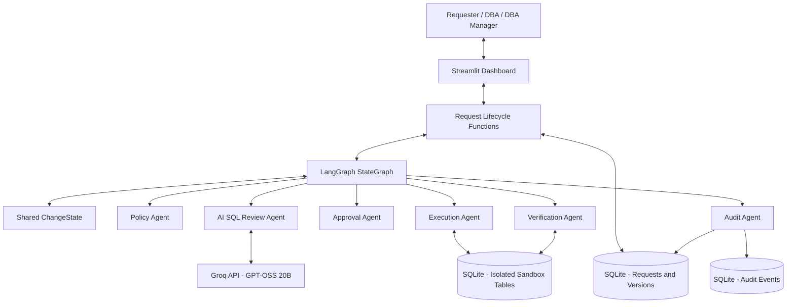
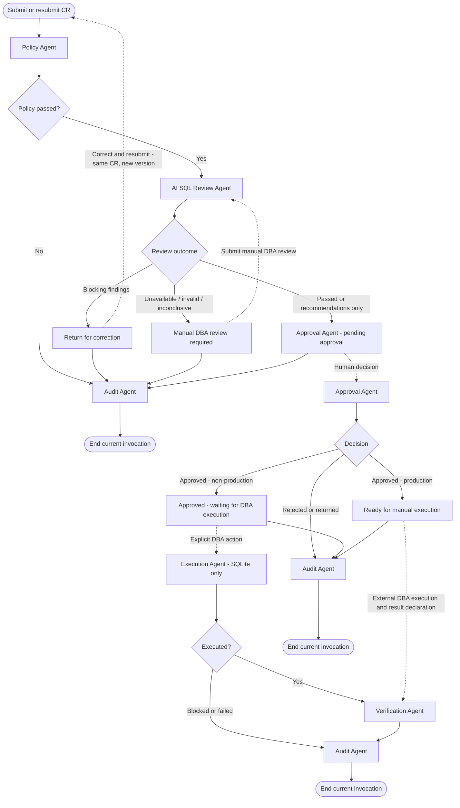

# DB Change Intelligence
**An Agentic AI-Powered Database Change Management System**  
SDAIA Academy | Agentic AI Capstone | Proof of Concept

Developed by **Amal ALmuteb*

## DB-Change-Intelligence
DB Change Intelligence is an AI-powered solution designed to streamline and automate the database change management lifecycle.

## Problem Statement
Manual database change reviews and approval processes can be time-consuming, inconsistent, and prone to human error, potentially increasing operational risks.
## Project Objective
To develop an intelligent six-agent system that validates change policies, reviews SQL scripts for potential errors and improvements, manages human approvals, and supports controlled non-production execution and verification.
## Expected Business Value
•	Reduce manual effort and operational risks <br>
•	Improve the efficiency of change reviews and approvals. <br>
•	Standardize SQL reviews, policy enforcement, and approval decisions. <br>
•	Enhance governance, accountability, and traceability. <br>

**Scope:** This is a training-only proof of concept (PoC). AI reviews are advisory. Supported non-production examples are executed against isolated demonstration data in SQLite only. Production changes are executed and verified externally by a DBA; the application records the DBA's declaration. No real database server is connected.

## Project Structure

The primary deliverable is the self-contained notebook `DB_Change_Intelligence_Submission.ipynb`. Running its source and assembly cells generates the following files in the Colab runtime:

```text
DB_Change_Intelligence_Submission.ipynb
README.md

Generated at runtime:
├── dci_sections/
│   ├── 01_core.py                   # Configuration, database and shared state
│   ├── 02_policy_agent.py           # Mandatory policy checks
│   ├── 03_ai_sql_review_agent.py    # Structured LLM review
│   ├── 04_approval_agent.py         # Human approval and authorization
│   ├── 05_execution_agent.py        # Controlled SQLite execution
│   ├── 06_verification_agent.py     # Result validation
│   ├── 07_audit_agent.py            # Audit events and request persistence
│   ├── 08_workflow_and_lifecycle.py # LangGraph and CR lifecycle
│   ├── 09_self_tests.py             # Automated functional tests
│   └── 10_streamlit_app.py          # Interactive user interface
├── db_change_intelligence.py        # Assembled application
├── dci_v6/
│   └── db_change_demo.sqlite3       # Runtime database
└── db_change_streamlit_fixed.log    # Runtime diagnostics
```

Each Python source section is defined in its own notebook cell. Section 4 assembles the ten sections in dependency order and validates Python syntax. Generated database files, runtime logs and credentials should not be committed to the repository.

## Architecture Diagram



The SQLite components in the diagram are logical groups of tables within the same local database. LangGraph coordinates the agents through a shared state and conditional edges. Human actions are initiated through the interface and validated by the lifecycle functions and relevant agents. Only the AI SQL Review Agent calls an LLM.

## Workflow Diagram



Dashed arrows represent a later human action or resubmission, not a continuously running graph. Request state is persisted in SQLite between invocations.

### Request lifecycle and approval policy

1. A new request receives a unique CR ID and version 1.
2. Policy validation is completed before any AI call.
3. A valid structured AI review proceeds to human approval; blocking findings return the request for correction. Unavailable, malformed or inconclusive AI results require a separate manual DBA review.
4. Resubmission retains the CR ID, increments the version, preserves earlier versions, resets review and approval, and restarts policy checks.
5. Approvals are bound to the current version and SHA-256 request fingerprint. Stale or unauthorized actions are blocked and logged.
6. Approved non-production requests require an explicit DBA execution action. Production requests follow a manual external execution path.
7. Verification and audit logging record the outcome. Every normal workflow invocation ends with Audit; denied human actions are also logged.

| Target environment | Required approver | Execution path |
|---|---|---|
| Development | DBA | Explicit DBA action; supported SQLite demo operations only |
| Test | DBA | Explicit DBA action; supported SQLite demo operations only |
| Pre-Production | DBA | Explicit DBA action; supported SQLite demo operations only |
| Production | DBA Manager | External DBA execution and manual result declaration only |

## Agents and Their Roles

| Agent | Approach | Responsibilities |
|---|---|---|
| Policy Agent | Rule-Based | Validates mandatory fields, environment and SQL policy controls. Requires production rollback plan and testing/backup declarations. |
| AI SQL Review Agent | LLM-Based | Reviews SQL across seven criteria using Groq and structured JSON output; validates results and routes findings or manual review. |
| Approval Agent | Human-in-the-Loop + Rules | Determines the required approver, records human decisions, and validates current-version authorization. |
| Execution Agent | Tool-Based | Blocks production, stale approval, invalid roles, duplicates and unsupported operations; runs allowlisted parameterized SQLite queries only. |
| Verification Agent | Rule-Based | Checks actual sandbox results against expected outcomes and records production DBA declarations without independently verifying production. |
| Audit Agent | Tool-Based | Persists CR history, actor, agent, version, timestamp, decisions and outcomes. |

### AI review criteria

The AI SQL Review Agent evaluates syntax, logical correctness, performance, data integrity, security, compatibility and best practices. Structured findings are classified as `PASS`, `BLOCKING`, `RECOMMENDATION` or `INCONCLUSIVE`.

| Review status | Next action |
|---|---|
| `PASSED` | Proceed to human approval |
| `PASSED_WITH_RECOMMENDATIONS` | Proceed to human approval with recommendations |
| `RETURNED_FOR_CORRECTION` | Correct and resubmit the request |
| `MANUAL_REVIEW_REQUIRED` | Require a manual DBA review before approval |

## Technologies & AI Tools Used

| Technology | Purpose |
|---|---|
| Python | Application logic, validation, lifecycle management and database operations |
| LangGraph | Shared state, agent nodes, conditional routing and workflow orchestration |
| Groq API | LLM inference and structured AI review |
| GPT-OSS 20B (`openai/gpt-oss-20b`) | Default model for SQL analysis and recommendations |
| JSON Schema | Structured response format and validation |
| Streamlit | Interactive dashboard, requests, reviews, approvals and execution controls |
| SQLite | Persistence, audit records, version history and isolated demo operations |
| SHA-256 | Fingerprint binding for the current request, review and approval |
| Google Colab | Development and demonstration runtime |
| Mermaid | Architecture and workflow visualization |

## Installation and Setup Instructions

### Prerequisites

- A Google account with access to [Google Colab](https://colab.research.google.com/).
- The project notebook: `DB_Change_Intelligence_Submission.ipynb`.
- A Groq API key for live AI review (optional for offline tests and manual DBA review). Create a key through the [Groq console](https://console.groq.com/keys).
- A private runtime containing synthetic data only.

### Setup steps

1. Open Google Colab and upload the notebook.
2. Connect to a Python runtime and execute Section 1 to install the dependencies:

   ```python
   %pip -q install -U langgraph groq streamlit
   ```

   SQLite is included in Python's standard library.

3. Open **Secrets** in Colab, create a secret named `GROQ_API_KEY`, provide the key and enable notebook access. Never place credentials in source code or commit them to GitHub.
4. Run Section 2 to configure the model, credential and SQLite database path.
5. Run Section 3, including all ten source-module cells.
6. Run Section 4 to assemble `db_change_intelligence.py` and validate its Python syntax.
7. Run Section 5 to execute the automated functional tests. These tests use synthetic AI responses and temporary SQLite storage; they do not call Groq or modify the demonstration database.
8. Optionally run Section 6 to display the compiled workflow in Mermaid format.

## How to Run the Project

### Launch the application

Run Section 7, **Streamlit Application Startup**, in the notebook. It launches the service on port `8502`, performs a health check and displays the interface within Colab using an internal iframe. If startup fails, inspect the diagnostic log through Section 9.

The interface provides six tabs: **Dashboard**, **Submit CR**, **Review & Correct**, **Approvals**, **Execution**, and **Audit & Versions**.

### Example 1 — Policy rejection

Create a Test request with a business justification and submit:

```sql
DELETE FROM dbo.Orders;
```

Expected outcome: `POLICY_REJECTED`. The missing `WHERE` clause blocks the request before AI review.

### Example 2 — AI review, correction, approval and execution

In **Submit CR**, use the following example details:

| Field | Example value |
|---|---|
| Requester | Demo Requester |
| Department | IT |
| System Name | Demo CRM |
| Database Platform | SQL Server |
| Environment | Test |
| Database Name | DemoDB |
| Business Justification | Activate customer account |

Submit this deliberately incomplete SQL statement:

```sql
UPDATE dbo.Customers SET Status= WHERE CustomerID=10;
```

1. Inspect the review in **Review & Correct**. A blocking syntax finding is expected; live AI findings may vary.
2. Correct and resubmit the same request using:

   ```sql
   UPDATE dbo.Customers SET Status='Active' WHERE CustomerID=10;
   ```

3. Confirm that the CR ID remains unchanged and the version increases from 1 to 2.
4. After a passed review, open **Approvals**, choose the simulated DBA role and record an approval.
5. In **Execution**, select the approved request and explicitly execute the change in the SQLite sandbox.
6. Inspect the before/after snapshots, affected rows, verification result and history in **Audit & Versions**. The seeded customer's status should change from `Inactive` to `Active`, with one affected row and final status `VERIFIED` if all checks succeed.

If Groq is unavailable or returns an invalid or inconclusive report, complete a separate manual DBA review before proceeding to approval.

### Example 3 — Production guardrails

Submit a Production request without a rollback plan or required confirmations and observe the policy rejection. Create a new compliant request with a rollback plan and confirmations of non-production testing and backup availability. After review, record a DBA Manager approval. The expected status is `READY_FOR_MANUAL_EXECUTION`. The application does not execute the production SQL. A DBA may record a simulated external execution and verification result with notes.

### Supported sandbox patterns

```sql
UPDATE dbo.Customers SET Status='Active' WHERE CustomerID=10;
DELETE FROM dbo.Orders WHERE CreatedAt < '2023-01-01';
SELECT TOP 10 * FROM dbo.Customers;
```

Only these supported operation patterns are translated into developer-authored, parameterized SQLite statements. The submitted SQL text is never executed directly. Oracle, PostgreSQL and MySQL requests are review-only in the current implementation.

### Automated functional validation

The notebook defines 25 functional checks covering policy enforcement, review routing, versioning, approvals, execution safeguards, SQLite operations, verification, production handling and audit logging. Section 5 runs the tests using the installed LangGraph workflow. An assertion failure stops the test run. Passing offline tests does not establish live Groq or Streamlit integration success; validate those in the actual runtime.

## Implementation Boundaries and Security

- Simulated roles are not authenticated identities or enterprise RBAC.
- Policy checks are simplified lexical heuristics, not a complete SQL parser or security certification.
- AI review cannot confirm SQL correctness without real schema, data and execution-plan context; model output cannot approve or execute changes.
- Backup and testing confirmations are requester declarations, not independently verified checks.
- No real database connections or automated production execution are provided.
- Execution errors can roll back the local SQLite savepoint; verification failures are routed to DBA review without automatic rollback of the completed change.
- Audit history supports traceability but is not tamper-proof.
- The Colab launcher reduces CORS/XSRF protections for private demonstration compatibility. Do not expose it publicly, reuse those settings in production, or submit confidential scripts or real customer data.

## Future Improvements

- Integrate enterprise identity management, authenticated RBAC and separation of duties.
- Integrate with IT service management (ITSM) and enterprise change-request systems.
- Expand safe execution coverage with controlled non-production database connectivity and isolated execution infrastructure.
- Introduce formal risk assessment, impact analysis, change scheduling and verified backup/testing evidence.
- Add stronger audit integrity, centralized monitoring and secure persistent storage.
- Develop approved rollback orchestration and enhanced post-change validation.
- Evaluate LLM accuracy, reliability and prompt-injection resistance using representative test datasets.

## SDAIA Academy GitHub Repository Link

[SDAIA Academy on GitHub](https://github.com/SDAIAAcademy)

This link points to the academy's GitHub organization. It is not a claim that this project has already been published to a specific repository.
